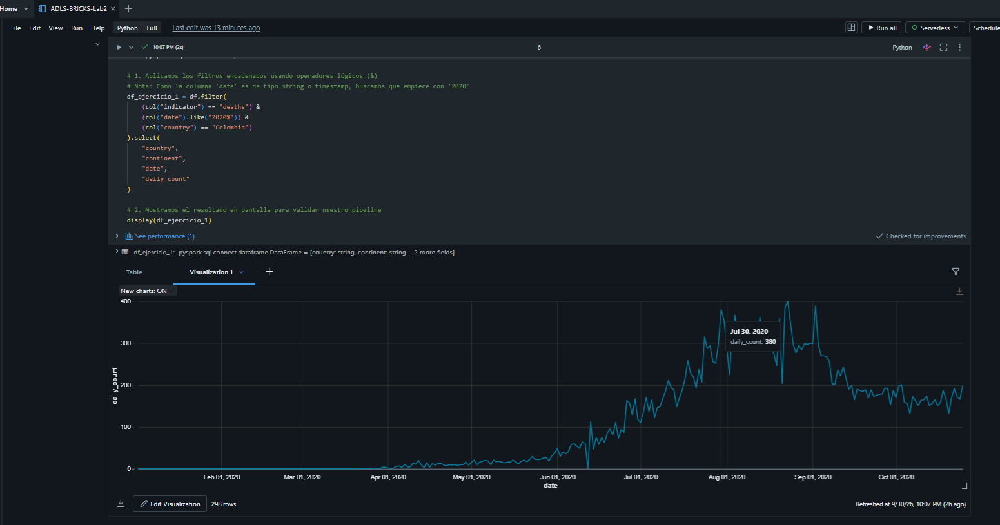
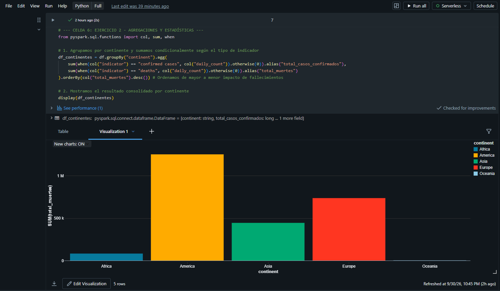
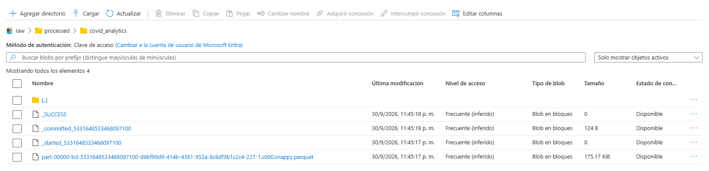
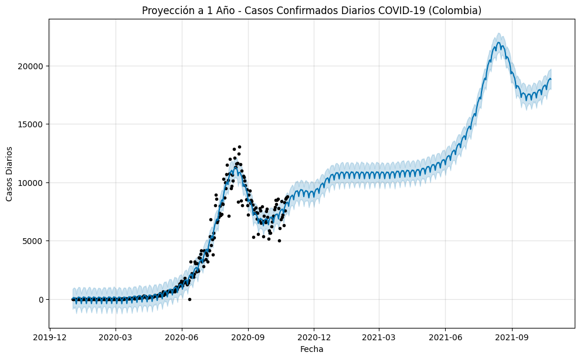
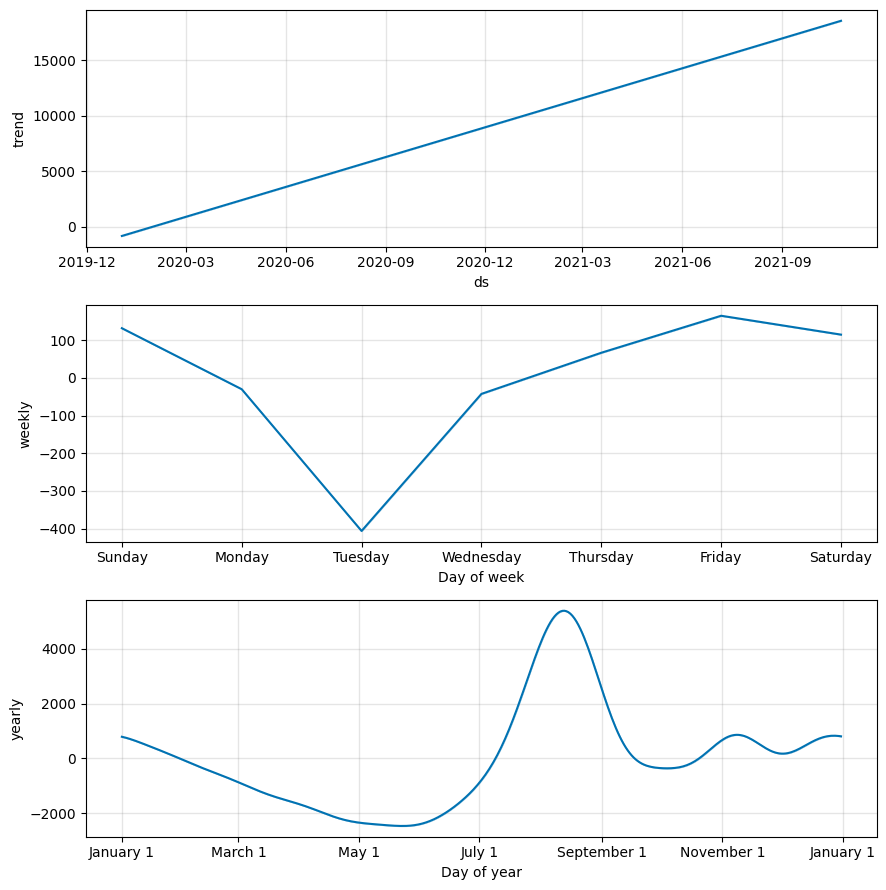

# Azure Data Engineering Lab: Data Pipelines con Databricks y ADLS Gen2 🚀

Este proyecto documenta la segunda fase del **Laboratorio 2**, donde se diseñó e implementó un pipeline de extracción, transformación y carga (**ETL**) utilizando **Apache Spark (PySpark)** y **Databricks**, conectado de forma segura a un **Azure Data Lake Storage Gen2 (ADLS)** bajo una arquitectura orientada a Big Data.

## 🛠️ Arquitectura y Tecnologías
*   **Origen de Datos:** Azure Data Lake Storage (ADLS Gen2) - Capa Raw (CSV).
*   **Procesamiento:** Azure Databricks (Clúster de un solo nodo / Spark 3.x).
*   **Lenguajes:** PySpark (Spark SQL API) y SQL Ansel de forma híbrida.
*   **Destino de Datos:** ADLS Gen2 - Capa Processed (Formato Parquet optimizado).

---

## 📈 Fases del Pipeline Implementado

### 1. Extracción y Persistencia Híbrida
Se consumió la data bruta de COVID-19 (`muertes.csv`) mediante autenticación efímera con Service Principal hacia Azure. Con la finalidad de optimizar el laboratorio y habilitar capacidades de Business Intelligence, la data en memoria se persistió en el Metastore de Databricks:
```python
# Persistencia en catálogo local
df.write.mode("overwrite").saveAsTable("tabla_covid_laboratorio")
```
Se validó la consistencia estructural usando comandos SQL nativos:
```sql
%sql
DESCRIBE TABLE tabla_covid_laboratorio;
```

### 2. Transformación y Enriquecimiento de Datos (ETL)
El pipeline ejecutó transformaciones secuenciales escalables para responder a necesidades críticas de análisis:

*   **Filtrado y Selección:** Aislamiento de curvas epidemiológicas específicas (ej. Fallecimientos en Colombia, año 2020) utilizando predicados lógicos optimizados (`.filter()`, `.like()`).
<p align="center">
  
</p>
*   **Agregación Condicional (Pivotado):** Consolidación de métricas distribuidas verticalmente (filas) hacia una estructura horizontal resumida por continentes, identificando a **América** como la región de mayor impacto con más de 1.25M de decesos.



*   **Métricas Relativas vs Cuantitativas:** Creación de la columna derivada `porcentaje_poblacion_afectada` para normalizar el impacto del virus omitiendo el sesgo del volumen poblacional:
    \[\text{Porcentaje} = \left( \frac{\text{daily\_count}}{\text{population}} \right) \times 100\]
*   **Auto-Join Complejo:** Transformación estructural de la data uniendo dos sub-dataframes (`casos` y `muertes`) mediante una llave compuesta (`country`, `date`) para aplanar el modelo de datos.

### 3. La Cereza del Pastel: Time Intelligence en Big Data
Para evitar cálculos pesados en herramientas de visualización como Power BI, se pre-calculó el desfase temporal directamente en el pipeline en la nube. Utilizando **Funciones de Ventana (Window Functions)**, se implementó un `LAG` para contrastar el comportamiento del día actual frente al día anterior por cada país:
```python
ventana_pais = Window.partitionBy("country").orderBy("date")
df_final = df_resultado_pipeline.withColumn("muertes_dia_anterior", lag("muertes_diarias", 1).over(ventana_pais))
```

### 4. Carga de Datos (Almacenamiento Distribuido)
El resultado final analítico fue exportado de vuelta al Data Lake de Azure en formato **Parquet**. La operación fue exitosa, validada por la generación automática del archivo de metadatos `_SUCCESS` y archivos partidos distribuidos (`part-*.parquet`), garantizando alta compresión y transaccionalidad atómica.


---

## 💡 Conclusiones del Laboratorio
*   **Normalización Analítica:** Evaluar impactos en términos porcentuales nivela el terreno de juego, exponiendo la verdadera vulnerabilidad de comunidades pequeñas que el análisis cuantitativo absoluto suele ocultar.
*   **Arquitectura Medallón:** Pasar datos de formatos planos (`.csv`) a formatos columnares binarios (`.parquet`) en capas refinadas (`processed`) optimiza drásticamente los costos de almacenamiento y los tiempos de cómputo en la nube.

## 🤖 Fase 5: Machine Learning Integrado (Time Series Forecasting con Prophet)
Para cerrar el ciclo analítico con broche de oro, se incorporó un modelo predictivo de Machine Learning directamente sobre los datos refinados de la capa *processed*. El objetivo fue proyectar a un año (**365 días**) la tendencia de los **casos confirmados diarios de COVID-19 en Colombia**.

### 1. Desafíos Técnicos de Entornos Restringidos (Databricks Free Edition)
Debido a las restricciones de la suscripción *student*, se utilizó **Databricks Community Edition**. Esto planteó dos retos de ingeniería que se resolvieron mediante patrones de código limpio:
* **Aislamiento de Contexto (Spark vs Pandas):** El modelo **Prophet** requiere DataFrames de Pandas de forma nativa. Se ejecutó una conversión controlada en memoria (`.toPandas()`) aprovechando que la muestra de datos ya estaba filtrada y optimizada para un solo país.
* **Seguridad y Escritura Efímera:** Para evitar bloqueos de políticas globales en el clúster gratuito (`[CONFIG_NOT_AVAILABLE]`), se replicó el patrón de **autenticación por opciones efímeras (`.option()`)** con el *Service Principal* de Azure directamente en el método de escritura de Spark.

```python
# Muestra del patrón de escritura efímera utilizado para salvar las restricciones del clúster
df_forecast_final.write \
    .option("fs.azure.account.auth.type", "OAuth") \
    .option("fs.azure.account.oauth.provider.type", "org.apache.hadoop.fs.azurebfs.oauth2.ClientCredsTokenProvider") \
    .option("fs.azure.account.oauth2.client.id", client_id) \
    .option("fs.azure.account.oauth2.client.secret", client_secret) \
    .option("fs.azure.account.oauth2.client.endpoint", f"https://microsoftonline.com{tenant_id}/oauth2/token") \
    .mode("overwrite") \
    .parquet(ruta_destino_ml)
```

### 2. Resultados e Insights del Modelo
El modelo identificó con éxito las estacionalidades semanales y anuales del comportamiento del virus. Los resultados finales incluyen el valor predicho (`prediccion_casos`) junto con sus intervalos de confianza superior e inferior.

<p align="center">
  
</p>



*Los gráficos de componentes generados demuestran cómo el modelo aísla la tendencia general de los picos estacionales de los fines de semana.*

### 3. Persistencia de Predicciones en el Data Lake
Los resultados predictivos no se quedaron aislados en el Notebook. Se transformaron de vuelta a un Spark DataFrame distribuido, se estandarizaron los nombres de las columnas bajo buenas prácticas analíticas y se almacenaron en el ADLS Gen2 en formato **Parquet** dentro de la ruta:
`covid_analytics/forecast_cases_colombia/`